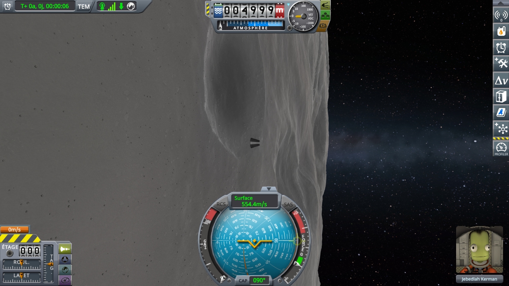

# Performance

Part of [KSP-MCPServer](../README.md). The short version is on the main page, under [Performance](../README.md#performance); here are the protocols and the figures.

Two questions, one campaign each, both timed frame by frame with
[KSPProfiler](https://github.com/KSPModdingLibs/KSPProfiler):

- **[Installed, and nobody calls it](#installed-and-nobody-calls-it)**: does a frame cost more with this mod
  in `GameData`, when no program sends it a request? Both sides played by hand, with the published
  KSPProfiler; the only difference is this mod. The answer: **nothing measurable**, on any row; the runs
  with it and the runs without it overlap.
- **[Driven by script](#driven-by-script)**: does a run played by a script through this mod read the same as
  one played by hand without it? This is what matters to a mod that publishes frame timings played by
  script. The answer: on the coroutines the terrain is updated in, the runs by script cost **at most about
  0.05 ms more per frame**, and no larger effect stands out of the spread between runs.

## What the server does in a frame

While nobody calls it, this mod does three things, all visible in [`Src/`](../Src):

- **Once a frame, on the main thread**, the `Update()` of its `MonoBehaviour`
  ([`KSPMCPServerMod.cs`](../Src/KSPMCPServerMod.cs)) calls `Subscribe()`, which returns on a boolean
  test once the game events are subscribed, then `Log.Flush()` ([`Log.cs`](../Src/Log.cs)), which takes a
  lock on the queue of messages logged off the main thread and returns when it is empty, then
  `MainThread.Pump()` ([`MainThread.cs`](../Src/Server/MainThread.cs)), which takes a lock on the queue of
  pending tool calls and returns when the queue is empty.
- **When two game events fire**, `onFloatingOriginShift` and `onFlightReady`, a handler counts the shifts
  of the floating origin or resets that count: a few assignments.
- **On a thread of its own**, the HTTP listener ([`McpHttpServer.cs`](../Src/Server/McpHttpServer.cs)) waits
  in `HttpListener.GetContext()` for a request. While it waits, it takes nothing from the main thread.

A tool runs only while a request is being served: the listener queues it, `Pump()` starts it in the next
frame's `Update()` as a coroutine of the mod's `MonoBehaviour`, and the listener waits for it to end.
Between the start and the stop of the captures below, no tool runs.

## The run

Both campaigns time the same run, on the same machine, the runs of each campaign in one session. Figures
from another machine, or another session of runs, are not comparable to these.

**The game.** KSP 1.12.5, in a 1280×720 window, vertical sync off (`SYNC_VBL = 0` in `settings.cfg`) and
no frame limit, terrain detail High, terrain scatter on at full density. With vertical sync or a frame
limit, the frame rate would follow the screen or the setting rather than what a frame costs.

**The save.** [`perfs/ref-mune-5km.sfs`](../perfs/ref-mune-5km.sfs), a sandbox game saved in KSP 1.12.5,
holding one Mk1 command pod on rails in a circular equatorial orbit 5 km over the Mun. Copy it into the
folder of a sandbox game in `saves`, and load it from that game (Alt+F9). Flying low over the Mun, the craft
keeps the terrain building new quads all along the run: the coroutines the terrain is updated in are busy.

**The steps.** Each run is a fresh KSP: `GameData` is only read at startup.

1. Load the save. Right after the load, turn the camera to look ahead along the orbit: in orbit the camera
   turns in the orbit's frame, so the Mun's edge stands upright on the screen. Stop when the Mun's ground
   fills the left two thirds of the screen, the sky the right third, the capsule in the middle against the
   ground:

   

   What the camera shows changes what a frame costs to draw, so it has to be the same in every run. The
   ground's share shrinks as the run goes on, to about half the screen at 1 min 40 s: the camera's frame
   does not turn with the craft. Leave it so.
2. Open the profiler's window, where it opens (the middle of the screen), KSP's interface shown.
   Captured frames at 10 000 (the most the window accepts; the profiler stops by itself when it is
   reached), *AutoCapture* off.
3. *Start capture* at 30 s of mission time, *Stop capture* at 1 min 40 s, at ×1 all along. Nothing is
   asked of the game in between. The craft is on rails: starting and stopping at the same mission time
   means flying over the same stretch of ground, and building the same quads.
4. *Export to CSV*. The CSV does not hold the number of captured frames: read it off the window.

In every run, no other window covers KSP's, and the mouse pointer stays outside it until it goes to *Stop
capture*. Copy
`KSP.log` before the next run: KSP overwrites it at every start.

A run is worth keeping when fewer than 10 000 frames were captured, so that the capture ended on *Stop*
and not before.

**Reading the CSV.** It repeats row names. Below, **Update** is the whole `Update` phase, the first
`Update` row; **Update → Update** is the `Update()` calls of every `MonoBehaviour`, this mod's among them,
the `Update` row right after it; **Update → Coroutines** is the coroutines run inside the `Update` phase,
among them the terrain's update, the first `Coroutines` row after the first `Update` row. **VSync** near
zero says the frame waited on the processor, not on the screen or the graphics card.

## Installed, and nobody calls it

KSP 1.12.5 with Harmony 2.2.1, ModuleManager 4.2.3, KSP Community Fixes 1.41.1 and KSPProfiler 1.0.0, with
the KsmUI library it ships with, in every run. The two configurations:

- **without**: nothing else;
- **idle**: this mod as well, with its settings as shipped. No program sends it a request.

Both played by hand, the same way, by [the run](#the-run). In every run, right after *Start capture*, the
keyboard went to another window, KSP's staying entirely visible, and the pointer came back over *Stop
capture* about ten seconds before 1 min 40 s. Three runs per configuration, the two configurations taken in
turn, in one session: the logs and CSVs are in
[`perfs/`](../perfs/README.md#installed-and-nobody-calls-it). All six ended on *Stop*, with 6 984 to 7 326
frames each.

### What a frame pays

In milliseconds per frame (every row of every run is
[with the runs](../perfs/README.md#the-figures-installed-and-idle)):

| | without 1 | idle 1 | without 2 | idle 2 | without 3 | idle 3 |
|---|---|---|---|---|---|---|
| frame time, mean | 9.87 | 9.59 | 9.87 | 10.04 | 9.69 | 9.87 |
| Update, mean | 2.50 | 2.36 | 2.49 | 2.52 | 2.43 | 2.46 |
| Update → Update, mean | 0.85 | 0.72 | 0.82 | 0.82 | 0.79 | 0.81 |
| Update → Coroutines, mean | 1.96 | 1.92 | 1.96 | 1.99 | 1.94 | 1.95 |
| Cameras render, mean | 3.48 | 3.43 | 3.50 | 3.52 | 3.45 | 3.52 |
| VSync, mean | 0.06 | 0.06 | 0.06 | 0.06 | 0.06 | 0.06 |
| profiler overhead, mean | 0.43 | 0.45 | 0.44 | 0.44 | 0.44 | 0.45 |

Averaged over the three runs of each configuration:

| | without | idle |
|---|---|---|
| frame time, mean | 9.810 | 9.833 |
| Update, mean | 2.473 | 2.447 |
| Update → Update, mean | 0.820 | 0.783 |
| Update → Coroutines, mean | 1.953 | 1.953 |
| Cameras render, mean | 3.477 | 3.490 |

On every row, the two sides overlap: the fastest run and the slowest are both *idle* ones (frame time 9.59
and 10.04 ms), and the three runs without this mod fall between them. **Update → Coroutines**, the row the
runs by script stayed above in [Driven by script](#driven-by-script), averages 1.953 ms on both sides: the
runs *idle* read 1.92 to 1.99, the runs *without* 1.94 to 1.96. **Update → Update**, where this mod's
`Update()` is counted, reads lower *idle* on average, because of one run, *idle 1*, faster than every other
on several rows at once. The profiler's own overhead reads 0.44 to 0.45 ms *idle* and 0.43 to 0.44 ms
*without*.

### What this says

**Installed, and called by nobody, this mod costs a frame nothing measurable**: no row tells the runs with
it from the runs without it, and the differences between the averages, a few hundredths of a millisecond,
run one way on some rows and the other way on others, smaller than the spread between runs of the same
side. That fits [what the server does in a frame](#what-the-server-does-in-a-frame): a boolean test and a
lock taken on an empty queue.

## Driven by script

KSP 1.12.5 with Harmony 2.2.1, ModuleManager 4.2.3, KSP Community Fixes 1.41.1 and KSPProfiler, with the
KsmUI library it ships with, in every run, and nothing else. The two configurations:

- **by hand**: KSPProfiler 1.0.0, without this mod, its buttons pressed by hand;
- **by script**: this mod, and [a fork of KSPProfiler](https://github.com/lhervier/KSP-ExtMod-KSPProfiler)
  which only adds this server's tools for its window's buttons — nothing in what it measures changed —
  pressed by [`run-perfs.py`](../perfs/automation/run-perfs.py), a Python script with no dependency. This
  server's on-screen messages are off (`screen_messages = false`), so that no message is drawn in the frames
  captured.

The two sides differ in those two mods, the fork with the build of KsmUI it ships with, and in who plays
the steps; nothing else. Both follow [the run](#the-run); by script, the camera is set at heading 204° in
the orbit's frame, pitch 0, which gives the framing of step 1, and the script sleeps through the capture.

Three runs per configuration, the two configurations taken in turn, in one session of runs, described with
the logs in [`perfs/`](../perfs/README.md#driven-by-script). All six ended on *Stop*, with about 7 000 to
7 374 frames each.

### What a frame pays

In milliseconds per frame (every row of every run is
[with the runs](../perfs/README.md#the-figures-driven-by-script)):

| | by script 1 | by hand 1 | by script 2 | by hand 2 | by script 3 | by hand 3 |
|---|---|---|---|---|---|---|
| frame time, mean | 9.58 | 9.68 | 9.75 | 9.57 | 9.94 | 9.52 |
| Update, mean | 2.34 | 2.35 | 2.37 | 2.35 | 2.38 | 2.34 |
| Update → Update, mean | 0.71 | 0.72 | 0.73 | 0.72 | 0.72 | 0.72 |
| Update → Coroutines, mean | 1.93 | 1.93 | 1.96 | 1.91 | 1.98 | 1.90 |
| Cameras render, mean | 3.51 | 3.49 | 3.48 | 3.42 | 3.60 | 3.43 |
| VSync, mean | 0.06 | 0.06 | 0.06 | 0.06 | 0.06 | 0.06 |
| profiler overhead, mean | 0.45 | 0.44 | 0.45 | 0.44 | 0.46 | 0.44 |

Averaged over the three runs of each configuration:

| | by hand | by script |
|---|---|---|
| frame time, mean | 9.590 | 9.757 |
| Update, mean | 2.347 | 2.363 |
| Update → Update, mean | 0.720 | 0.720 |
| Update → Coroutines, mean | 1.913 | 1.957 |
| Cameras render, mean | 3.447 | 3.530 |

On **frame time, Update, Update → Update and Cameras render**, the two sides overlap. The mean frame time is 0.17 ms higher by script on
average, but the three runs by script spread by 0.36 ms, twice that. **Update → Update**, where this
mod's `Update()` is counted, reads the same on both sides.

On **Update → Coroutines**, the runs by script read 1.93, 1.96 and 1.98 ms, the runs by hand 1.93, 1.91
and 1.90 ms. The runs by script average 0.04 ms higher, about 2 %, and none of them reads lower than a
run by hand: the lowest by script equals the highest by hand. That difference is the size of the spread
within each side, 0.03 ms by hand and 0.05 ms by script.

The profiler's own overhead reads 0.45 to 0.46 ms by script against 0.44 ms by hand: 0.01 to 0.02 ms more.

### What this says

**At most about 0.05 ms per frame**, on the coroutines the terrain is updated in; nothing larger stands
out of the spread between runs. That is not "no effect": in this session, the runs by script stayed on
the costlier side of that row.

What the server does in a frame when nobody calls it — a boolean test, and a lock taken on an empty queue
(see [What the server does in a frame](#what-the-server-does-in-a-frame)) — cannot account for 0.04 ms by
itself, and the row it is counted in reads the same on both sides. This campaign does not tell the server
apart from the fork of the profiler. [Installed, and nobody calls it](#installed-and-nobody-calls-it) does,
in another session: there, the server at rest, as it is during these captures, costs nothing measurable.
The 0.04 ms comes from something else the two sides here do not share, which this campaign cannot name.

For a page that publishes runs played by script through this server: compare configurations played the
same way, all by script. Whatever the server costs is then paid by every configuration alike.
